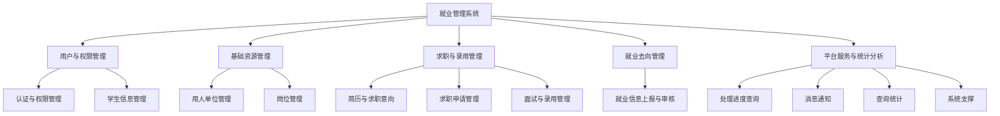
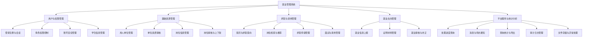

# 就业管理系统 功能模块划分

> 高校/学校场景的毕业生就业管理与服务系统。
> 在现有实训项目基础上，加入第一优先级功能后，将 12 个子模块归纳为 **5 个大模块**。

**状态标记说明**
- ✅ 已完成（现有项目已实现）
- 🆕 本次新增（第一优先级：简历与求职意向、岗位审核/上下架、单位资质审核、站内消息通知）
- ⏳ 后续扩展（第二/第三优先级，暂不实现）

---

## 层次结构图

> 自上而下：就业管理系统 → 大模块 → 子模块。

## 概要设计说明书作图说明

> 概要设计阶段在软件需求说明书层次结构图的基础上继续分解模块，并分别使用层次图（H 图）、HIPO 图和 Yourdon 结构图描述功能层次、模块编号及程序调用关系。三类图使用同一组业务名称，但表达目的不同，不能相互替代。

**统一作图规范**

- 图面统一采用白色背景、黑色文字、黑色框线和黑色连接线，不使用彩色填充、阴影或装饰性图标。
- 模块框保持水平、垂直对齐；同一层级的框体尺寸和间距尽量一致，连接线优先使用直线并避免交叉。
- 层次图与 HIPO 图表示功能分解关系，连接线不带箭头；结构图表示程序调用与数据传递，使用带空心圆和实心箭头的耦合线。
- 图中的模块名称、编号和说明文字必须与概要设计说明书正文、模块表及程序标识符保持一致。

### 1. 层次图（H 图）

> 自上而下：就业管理系统 → 5 个大模块 → 20 个设计子模块。H 图强调功能模块的包含和分解关系，不表示程序调用方向。

- H 图保留需求层次结构图中的系统名称、5 个大模块和 12 个原始子模块语义，但概要设计阶段不再直接照搬需求图，而是进一步分解安全控制、审核控制、材料文件、流程追踪和运行支撑等辅助模块。
- H 图采用“就业管理系统 → 5 个大模块 → 20 个设计子模块”的三级结构。原“认证与权限管理”细化为登录注册与会话、角色权限控制、账号安全管理；原“系统支撑”细化为审计日志管理、文件存储与异常处理；同时把单位资质审核、岗位审核与上下架、证明材料管理、就业审核与补正、统计导出等设计职责独立成模块。
- 图形统一使用白底、粗黑框、粗黑连接线和黑字；第二层大模块横向排列，第三层子模块采用竖排文字框，与软件需求说明书中的层次结构图版式保持一致。

#### H 图模块总览

| 大模块 | 设计子模块 |
|---|---|
| 用户与权限管理 | 登录注册与会话、角色权限控制、账号安全管理、学生信息管理 |
| 基础资源管理 | 用人单位管理、单位资质审核、岗位信息管理、岗位审核与上下架 |
| 求职与录用管理 | 简历与求职意向、岗位检索与推荐、求职申请管理、面试与录用管理 |
| 就业去向管理 | 就业信息上报、证明材料管理、就业审核与补正 |
| 平台服务与统计分析 | 处理进度查询、消息与待办通知、查询统计与导出、审计日志管理、文件存储与异常处理 |

### 2. HIPO 图

> HIPO 图在 H 图的相同三级结构上增加模块编号，用于从需求、概要设计到程序实现之间进行追踪。顶层系统不编号，其余模块按照“大模块编号.子模块编号”标识。

**编号规则**

| 大模块 | 大模块编号 | 子模块编号范围 |
|---|---:|---:|
| 用户与权限管理 | 1.0 | 1.1～1.4 |
| 基础资源管理 | 2.0 | 2.1～2.4 |
| 求职与录用管理 | 3.0 | 3.1～3.4 |
| 就业去向管理 | 4.0 | 4.1～4.3 |
| 平台服务与统计分析 | 5.0 | 5.1～5.5 |

```mermaid
graph TD
    I[就业管理系统]
    I --> I1[用户与权限管理<br/>1.0]
    I --> I2[基础资源管理<br/>2.0]
    I --> I3[求职与录用管理<br/>3.0]
    I --> I4[就业去向管理<br/>4.0]
    I --> I5[平台服务与统计分析<br/>5.0]

    I1 --> I11[登录注册与会话<br/>1.1]
    I1 --> I12[角色权限控制<br/>1.2]
    I1 --> I13[账号安全管理<br/>1.3]
    I1 --> I14[学生信息管理<br/>1.4]

    I2 --> I21[用人单位管理<br/>2.1]
    I2 --> I22[单位资质审核<br/>2.2]
    I2 --> I23[岗位信息管理<br/>2.3]
    I2 --> I24[岗位审核与上下架<br/>2.4]

    I3 --> I31[简历与求职意向<br/>3.1]
    I3 --> I32[岗位检索与推荐<br/>3.2]
    I3 --> I33[求职申请管理<br/>3.3]
    I3 --> I34[面试与录用管理<br/>3.4]

    I4 --> I41[就业信息上报<br/>4.1]
    I4 --> I42[证明材料管理<br/>4.2]
    I4 --> I43[就业审核与补正<br/>4.3]

    I5 --> I51[处理进度查询<br/>5.1]
    I5 --> I52[消息与待办通知<br/>5.2]
    I5 --> I53[查询统计与导出<br/>5.3]
    I5 --> I54[审计日志管理<br/>5.4]
    I5 --> I55[文件存储与异常处理<br/>5.5]
```

**作图要求**

- HIPO 图的模块名称、层次、排列顺序必须与 H 图完全一致，只增加编号，不新增或删除模块。
- 第二层模块框内采用“大模块名称 + `x.0`”，第三层模块框内采用“子模块名称 + `x.y`”。
- 编号按所属大模块连续排列，不因页面换行、版式调整或程序包名称改变而重新编号。

### 3. Yourdon 结构图

> 结构图描述程序模块之间的调用和数据传递关系。它以主控模块为入口，将 H 图中的细粒度功能职责聚合为可调用的处理模块，因此不机械复制 H 图中的 20 个设计子模块。

- 结构图表达程序模块的调用与数据传递关系，不直接复制 H 图的功能层次。
- 就业管理系统主控模块向下调用用户与权限处理、基础资源处理、求职与录用处理、就业去向处理、平台服务处理五个主处理模块。
- 五个主处理模块分别展开两个职责聚合模块：登录注册与会话/权限与账号安全、单位与资质处理/岗位与上架审核、简历与岗位检索/申请面试与录用、就业上报与材料/审核与退回补正、进度消息与待办/统计日志与异常。
- 数据耦合线尾端使用黑框白底空心圆，目标端使用实心黑色箭头；文字必须与对应线段平行并放在线段侧边，不得与箭头、空心圆、模块框或其他文字重合。
- 图面采用紧凑的三级布局：主控模块居中置顶，五个主处理模块横向排列，十个职责聚合模块排列在底层。

#### 主控模块与主处理模块的数据名称

| 主处理模块 | 主控模块传入 | 主处理模块返回 |
|---|---|---|
| 用户与权限处理 | 用户请求 | 鉴权结果 |
| 基础资源处理 | 资源请求 | 资源结果 |
| 求职与录用处理 | 求职请求 | 录用结果 |
| 就业去向处理 | 上报资料 | 审核结果 |
| 平台服务处理 | 服务请求 | 服务结果 |

#### 主处理模块与职责聚合模块的关系

| 主处理模块 | 左侧职责聚合模块 | 右侧职责聚合模块 |
|---|---|---|
| 用户与权限处理 | 登录注册与会话 | 权限与账号安全 |
| 基础资源处理 | 单位与资质处理 | 岗位与上架审核 |
| 求职与录用处理 | 简历与岗位检索 | 申请面试与录用 |
| 就业去向处理 | 就业上报与材料 | 审核与退回补正 |
| 平台服务处理 | 进度消息与待办 | 统计日志与异常 |

底层调用统一使用“输入数据/处理结果”和“业务数据/返回结果”两组双向数据名称。箭线只表示模块间的数据调用，不表示数据库表之间的关联，也不替代 E-R 图或业务流程图。

---

## 模块总览（大模块 → 子模块）

- **一、用户与权限管理**
  - 1.1 认证与权限管理 ✅
  - 1.2 学生信息管理 ✅
- **二、基础资源管理**
  - 2.1 用人单位（企业库）管理 ✅ + 🆕
  - 2.2 岗位管理 ✅ + 🆕
- **三、求职与录用管理**
  - 3.1 简历与求职意向 🆕
  - 3.2 求职申请管理 ✅
  - 3.3 面试与录用管理 ✅
- **四、就业去向管理**
  - 4.1 就业信息上报与审核 ✅
- **五、平台服务与统计分析**
  - 5.1 处理进度查询 ✅
  - 5.2 消息通知 🆕
  - 5.3 查询统计 ✅
  - 5.4 系统支撑 ✅

---

# 一、用户与权限管理

> 系统的安全与用户入口层，负责身份认证、角色权限与用户资料管理。

## 1.1 认证与权限管理 ✅

| 功能点 | 说明 | 状态 |
|---|---|---|
| 登录/登出 | 学生、学校负责人两类角色 | ✅ |
| 学生注册 | 登录页自助注册 | ✅ |
| 密码安全 | BCrypt 加密存储、连续失败 5 次锁定 15 分钟 | ✅ |
| 防护 | 写操作 CSRF 防护、退出登录需 POST | ✅ |

## 1.2 学生信息管理 ✅

| 功能点 | 说明 | 状态 |
|---|---|---|
| 学生管理（负责人端） | 新增/编辑/删除/重置密码/禁用启用 | ✅ |
| 个人中心（学生端） | 修改本人资料与密码 | ✅ |

---

# 二、基础资源管理

> 用人单位与岗位两大基础数据资源，是求职与招聘的前提。

## 2.1 用人单位（企业库）管理 ✅ + 🆕

| 功能点 | 说明 | 状态 |
|---|---|---|
| 单位信息维护 | 单位基本信息的增删改查 | ✅ |
| 单位资质材料 | 营业执照等资质材料上传 | 🆕 |
| 单位资质审核 | 负责人审核资质（通过/驳回），通过后方可发布岗位 | 🆕 |
| 审核状态管理 | 单位审核状态、信用状态标记 | 🆕 |

## 2.2 岗位管理 ✅ + 🆕

| 功能点 | 说明 | 状态 |
|---|---|---|
| 岗位发布 | 负责人录入岗位信息 | ✅ |
| 岗位列表与检索 | 岗位列表、关键字/条件筛选、详情页 | ✅ |
| 岗位审核 | 待审核 → 通过 / 驳回，通过后才能上架 | 🆕 |
| 上架/下架 | 手动上下架控制 | 🆕 |
| 有效期管理 | 过期自动下架 | 🆕 |

---

# 三、求职与录用管理

> 核心业务主流程：从学生投递简历、申请岗位，到负责人审核、面试、录用。

## 3.1 简历与求职意向 🆕

| 功能点 | 说明 | 状态 |
|---|---|---|
| 学生在线简历 | 简历填写与维护，支持多份 | 🆕 |
| 求职意向 | 意向行业/岗位/城市设置 | 🆕 |
| 简历关联投递 | 申请岗位时关联简历 | 🆕 |
| 意向推荐 | 按求职意向推荐岗位（可选） | 🆕 |

## 3.2 求职申请管理 ✅

| 功能点 | 说明 | 状态 |
|---|---|---|
| 岗位查询与申请 | 学生查询并申请岗位 | ✅ |
| 申请列表 | 学生端"我的申请"、负责人端申请列表（筛选/分页） | ✅ |

## 3.3 面试与录用管理 ✅

| 功能点 | 说明 | 状态 |
|---|---|---|
| 申请初审 | 通过/不通过（不通过必填原因） | ✅ |
| 面试安排 | 时间、地点登记 | ✅ |
| 面试结果 | 面试通过/未通过 | ✅ |
| 录用登记 | 已录用/未录用 | ✅ |
| 状态机校验 | `ApplicationFlow` 校验非法操作 | ✅ |

---

# 四、就业去向管理

> 毕业生就业去向的登记、材料审核与确认闭环。

## 4.1 就业信息上报与审核 ✅

| 功能点 | 说明 | 状态 |
|---|---|---|
| 就业上报 | 学生自主上报就业信息 + 证明材料 | ✅ |
| 材料管理 | 上传/下载（UUID 重命名、白名单、5MB 上限） | ✅ |
| 就业审核 | 确认通过 / 退回补正（退回必填内容） | ✅ |
| 补正重报闭环 | 原记录修改重报，重报次数 +1，回到待审核 | ✅ |

---

# 五、平台服务与统计分析

> 跨模块的支撑服务：进度查询、消息通知、数据统计与系统通用能力。

## 5.1 处理进度查询 ✅

| 功能点 | 说明 | 状态 |
|---|---|---|
| 审核时间线 | 负责人端/学生端查看完整处理进度（`audit_log`） | ✅ |
| 进度入口 | 我的申请/就业上报页接入进度查看 | ✅ |

## 5.2 消息通知 🆕

| 功能点 | 说明 | 状态 |
|---|---|---|
| 站内信 | 学生/负责人收件箱 | 🆕 |
| 状态变更通知 | 审核、录用、退回补正等自动发通知 | 🆕 |
| 待办提醒 | 待审核、待面试等事项提醒 | 🆕 |
| 已读/未读 | 消息阅读状态管理 | 🆕 |

## 5.3 查询统计 ✅

| 功能点 | 说明 | 状态 |
|---|---|---|
| 概览指标 | 8 项核心指标 | ✅ |
| 分布统计 | 岗位/单位申请量 Top10、专业分布、月度趋势、审核状态、就业去向 | ✅ |
| 筛选与导出 | 时间范围筛选、CSV 导出 | ✅ |

## 5.4 系统支撑 ✅

| 功能点 | 说明 | 状态 |
|---|---|---|
| 审计日志 | 状态变更留痕（`audit_log`） | ✅ |
| 文件存储 | 证明材料安全存储 | ✅ |
| 通用组件 | 分页、CSV 导出、全局异常处理、时间解析 | ✅ |

---

## 后续可扩展模块（暂不实现）

| 优先级 | 模块 | 归属大模块 |
|---|---|---|
| 第二 | 多级角色与数据权限 | 用户与权限管理 |
| 第二 | 就业去向分类、就业率口径 | 就业去向管理 |
| 第二 | 图表与报表升级（ECharts/xlsx） | 平台服务与统计分析 |
| 第三 | 招聘会/宣讲会 | 基础资源管理 |
| 第三 | 网上签约（三方协议） | 就业去向管理 |
| 第三 | 就业质量调查 | 平台服务与统计分析 |
| 第三 | 数据上报对接 | 平台服务与统计分析 |

---

## 模块对照（现有 → 目标）

| 大模块 | 现有状态 | 本次新增 |
|---|---|---|
| 用户与权限管理 | 认证权限 + 学生管理 | — |
| 基础资源管理 | 单位/岗位基本信息 | 🆕 单位资质审核、岗位审核/上下架/有效期 |
| 求职与录用管理 | 申请 + 面试录用 | 🆕 简历与求职意向、简历关联投递 |
| 就业去向管理 | 上报 + 审核闭环 | — |
| 平台服务与统计分析 | 进度查询 + 统计 + 支撑 | 🆕 消息通知 |
